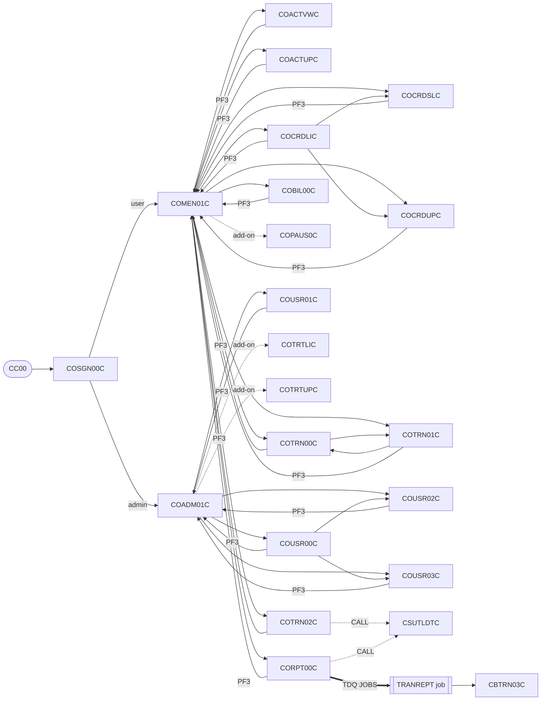
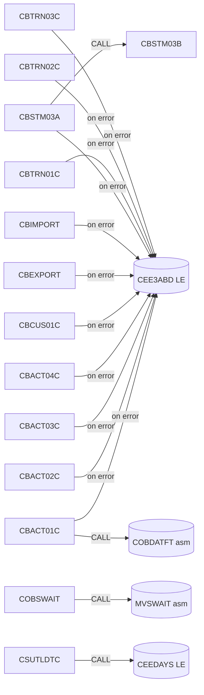
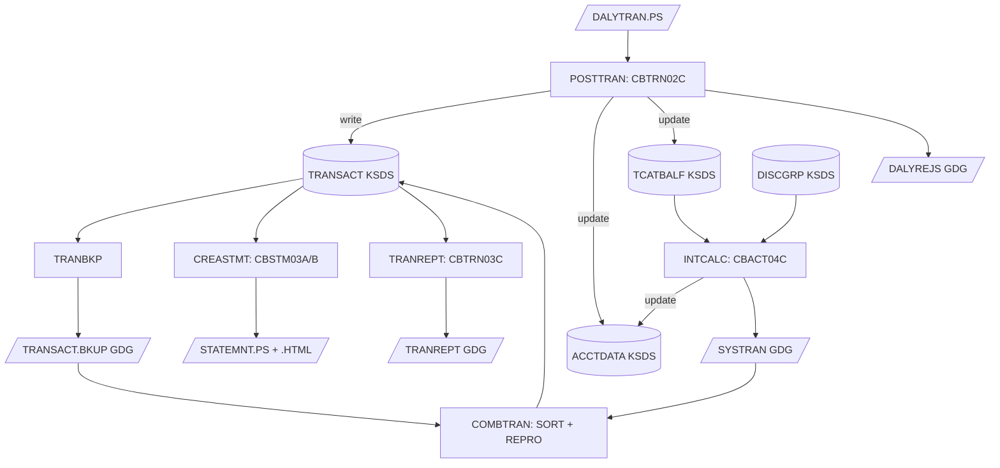

# CardDemo inventory (base application)

Scope: the base application only, meaning VSAM, CICS and batch. That covers the 31 COBOL programs in `app/cbl`, the VSAM and sequential files they use, the 17 BMS mapsets in `app/bms`, and the batch schedule. The three add-on modules under `app/app-*` are listed at the end for reference only. They are out of scope for this migration.

Everything below was read from the source in this repo: `SELECT/ASSIGN` and `OPEN` modes for batch files, `EXEC CICS` verbs for online files, `COPY` statements, `CALL` / `EXEC CICS XCTL` targets, `EXEC PGM=` in `app/jcl` and `app/proc`, `DEFINE CLUSTER / ALTERNATEINDEX` in `app/jcl`, and `DEFINE FILE / TRANSACTION` in `app/csd/CARDDEMO.CSD`. `scripts/check_inventory.py` checks that every program, mapset and VSAM cluster in the source appears in this document, and CI runs that check.

Dataset names drop the `AWS.M2.CARDDEMO.` prefix (the HLQ).

## 1. Programs (31)

### 1.1 Batch programs (12 `CB*`)

| Program | Purpose | Copybooks | Reads | Writes / updates | Calls | Run by JCL |
|---|---|---|---|---|---|---|
| CBACT01C | Dump the account master to three test output formats | CVACT01Y, CODATECN | ACCTFILE → `ACCTDATA.VSAM.KSDS` (seq) | OUTFILE → `ACCTDATA.PSCOMP` (FB 107), ARRYFILE → `ACCTDATA.ARRYPS` (FB 110), VBRCFILE → `ACCTDATA.VBPS` (VB 84) | COBDATFT (asm, `app/asm`), CEE3ABD | READACCT |
| CBACT02C | Print the card master | CVACT02Y | CARDFILE → `CARDDATA.VSAM.KSDS` (seq) | SYSOUT | CEE3ABD | READCARD |
| CBACT03C | Print the card cross-reference | CVACT03Y | XREFFILE → `CARDXREF.VSAM.KSDS` (seq) | SYSOUT | CEE3ABD | READXREF |
| CBACT04C | Interest calculation. Takes a date as PARM, e.g. `PARM='2022071800'` | CVTRA01Y, CVACT03Y, CVTRA02Y, CVACT01Y, CVTRA05Y | TCATBALF → `TCATBALF.VSAM.KSDS` (seq); XREFFILE → `CARDXREF.VSAM.KSDS` (random, alt key via XREFFIL1 → `CARDXREF.VSAM.AIX.PATH`); DISCGRP → `DISCGRP.VSAM.KSDS` (random) | ACCTFILE → `ACCTDATA.VSAM.KSDS` (I-O, rewrite); TRANSACT → `SYSTRAN(+1)` GDG (FB 350, new) | CEE3ABD | INTCALC |
| CBCUS01C | Print the customer master | CVCUS01Y | CUSTFILE → `CUSTDATA.VSAM.KSDS` (seq) | SYSOUT | CEE3ABD | READCUST |
| CBEXPORT | Export all masters into one multi-record export file | CVCUS01Y, CVACT01Y, CVACT03Y, CVTRA05Y, CVACT02Y, CVEXPORT | CUSTFILE, ACCTFILE, XREFFILE, TRANSACT, CARDFILE (all VSAM KSDS, seq) | EXPFILE → `EXPORT.DATA` (KSDS, 500) | CEE3ABD | CBEXPORT |
| CBIMPORT | Split the export file back into one flat file per entity | CVCUS01Y, CVACT01Y, CVACT03Y, CVTRA05Y, CVACT02Y, CVEXPORT | EXPFILE → `EXPORT.DATA` | CUSTOUT → `CUSTDATA.IMPORT` (500), ACCTOUT → `ACCTDATA.IMPORT` (300), XREFOUT → `CARDXREF.IMPORT` (50), TRNXOUT → `TRANSACT.IMPORT` (350), ERROUT → `IMPORT.ERRORS` (132), CARDOUT (has a `SELECT` but no DD in `CBIMPORT.jcl`) | CEE3ABD | CBIMPORT |
| CBSTM03A | Account statements, plain text and HTML. Main program: it does no VSAM I/O itself and calls CBSTM03B for all file access | COSTM01, CVACT03Y, CUSTREC, CVACT01Y | (through CBSTM03B) | STMTFILE → `STATEMNT.PS` (FB 80), HTMLFILE → `STATEMNT.HTML` (FB 100) | CBSTM03B, CEE3ABD | CREASTMT (step STEP040) |
| CBSTM03B | File-access subroutine for CBSTM03A (open / read / close by function code) | none (records passed in linkage) | TRNXFILE → `TRXFL.VSAM.KSDS` (seq), XREFFILE → `CARDXREF.VSAM.KSDS` (seq), CUSTFILE → `CUSTDATA.VSAM.KSDS` (random), ACCTFILE → `ACCTDATA.VSAM.KSDS` (random) | none | none | called from CREASTMT via CBSTM03A |
| CBTRN01C | Validate daily transactions against the masters. Read-only, with no writes | CVTRA06Y, CVCUS01Y, CVACT03Y, CVACT02Y, CVACT01Y, CVTRA05Y | DALYTRAN (seq), CUSTFILE, XREFFILE, CARDFILE, ACCTFILE, TRANFILE (all KSDS, random) | SYSOUT | CEE3ABD | **none in `app/jcl`** |
| CBTRN02C | Post daily transactions. This is the core batch job | CVTRA06Y, CVTRA05Y, CVACT03Y, CVACT01Y, CVTRA01Y | DALYTRAN → `DALYTRAN.PS`; XREFFILE → `CARDXREF.VSAM.KSDS` (random) | TRANFILE → `TRANSACT.VSAM.KSDS` (write); DALYREJS → `DALYREJS(+1)` GDG (FB 430); ACCTFILE → `ACCTDATA.VSAM.KSDS` (I-O); TCATBALF → `TCATBALF.VSAM.KSDS` (I-O) | CEE3ABD | POSTTRAN |
| CBTRN03C | Transaction detail report for a date range | CVTRA05Y, CVACT03Y, CVTRA03Y, CVTRA04Y, CVTRA07Y | TRANFILE → `TRANSACT.DALY(+1)` (seq, sorted copy); CARDXREF → `CARDXREF.VSAM.KSDS`; TRANTYPE → `TRANTYPE.VSAM.KSDS`; TRANCATG → `TRANCATG.VSAM.KSDS` (all random); DATEPARM → `DATEPARM` | TRANREPT → `TRANREPT(+1)` GDG (FB 133) | CEE3ABD | TRANREPT (JCL), and the `TRANREPT` proc that CORPT00C submits |

### 1.2 Online CICS programs (17 `CO*`)

Every online program copies `COCOM01Y` (the COMMAREA passed between programs), `DFHAID` and `DFHBMSCA`, plus its own symbolic map from `app/cpy-bms`. Those are left out of the copybook column below. CICS file names map to datasets as shown in §2.1.

| Program | Tran | Mapset / map | Function | Other copybooks | CICS files and verbs | Transfers to (XCTL) / CALL |
|---|---|---|---|---|---|---|
| COSGN00C | CC00 | COSGN00 / COSGN0A | Sign-on | COTTL01Y, CSDAT01Y, CSMSG01Y, CSUSR01Y | USRSEC: READ | XCTL COADM01C (admin user), COMEN01C (regular user) |
| COMEN01C | CM00 | COMEN01 / COMEN1A | Main menu | COMEN02Y (menu table), COTTL01Y, CSDAT01Y, CSMSG01Y, CSUSR01Y | none | XCTL to the selected option: COACTVWC, COACTUPC, COCRDLIC, COCRDSLC, COCRDUPC, COTRN00C, COTRN01C, COTRN02C, CORPT00C, COBIL00C, COPAUS0C (add-on); COSGN00C |
| COADM01C | CA00 | COADM01 / COADM1A | Admin menu | COADM02Y (admin menu table), COTTL01Y, CSDAT01Y, CSMSG01Y, CSUSR01Y | none | XCTL to the selected option: COUSR00C, COUSR01C, COUSR02C, COUSR03C, COTRTLIC and COTRTUPC (add-on); COSGN00C |
| COACTVWC | CAVW | COACTVW / CACTVWA | Account view | CVCRD01Y, COTTL01Y, CSDAT01Y, CSMSG01Y, CSMSG02Y, CSUSR01Y, CVACT01Y, CVACT02Y, CVACT03Y, CVCUS01Y, CSSTRPFY | CXACAIX: READ; ACCTDAT: READ; CUSTDAT: READ | XCTL calling program or COMEN01C |
| COACTUPC | CAUP | COACTUP / CACTUPA | Account update (account and customer) | CSUTLDWY, CVCRD01Y, CSLKPCDY, COTTL01Y, CSDAT01Y, CSMSG01Y, CSMSG02Y, CSUSR01Y, CVACT01Y, CVACT03Y, CVCUS01Y, CSSETATY, CSSTRPFY, CSUTLDPY | CXACAIX: READ; ACCTDAT: READ, READ UPDATE, REWRITE; CUSTDAT: READ, READ UPDATE, REWRITE | XCTL calling program or COMEN01C |
| COCRDLIC | CCLI | COCRDLI / CCRDLIA | Credit card list | CVCRD01Y, COTTL01Y, CSDAT01Y, CSMSG01Y, CSUSR01Y, CVACT02Y, CSSTRPFY | CARDDAT: STARTBR, READNEXT, READPREV, ENDBR | XCTL COMEN01C, COCRDSLC (view), COCRDUPC (update) |
| COCRDSLC | CCDL | COCRDSL / CCRDSLA | Credit card view | CVCRD01Y, COTTL01Y, CSDAT01Y, CSMSG01Y, CSMSG02Y, CSUSR01Y, CVACT02Y, CVCUS01Y, CSSTRPFY | CARDDAT: READ; CARDAIX: READ | XCTL calling program or COMEN01C |
| COCRDUPC | CCUP | COCRDUP / CCRDUPA | Credit card update | CVCRD01Y, COTTL01Y, CSDAT01Y, CSMSG01Y, CSMSG02Y, CSUSR01Y, CVACT02Y, CVCUS01Y, CSSTRPFY | CARDDAT: READ, READ UPDATE, REWRITE | XCTL calling program or COMEN01C |
| COTRN00C | CT00 | COTRN00 / COTRN0A | Transaction list | COTTL01Y, CSDAT01Y, CSMSG01Y, CVTRA05Y | TRANSACT: STARTBR, READNEXT, READPREV, ENDBR | XCTL COTRN01C (select), COMEN01C, COSGN00C |
| COTRN01C | CT01 | COTRN01 / COTRN1A | Transaction view | COTTL01Y, CSDAT01Y, CSMSG01Y, CVTRA05Y | TRANSACT: READ (with UPDATE option, never rewritten) | XCTL COMEN01C, COTRN00C, COSGN00C |
| COTRN02C | CT02 | COTRN02 / COTRN2A | Transaction add | COTTL01Y, CSDAT01Y, CSMSG01Y, CVTRA05Y, CVACT01Y, CVACT03Y | CXACAIX: READ; CCXREF: READ; TRANSACT: STARTBR, READPREV, ENDBR (to find the last id), WRITE | CALL CSUTLDTC; XCTL COMEN01C, COSGN00C |
| CORPT00C | CR00 | CORPT00 / CORPT0A | Transaction report request | COTTL01Y, CSDAT01Y, CSMSG01Y, CVTRA05Y | No file I/O. `WRITEQ TD QUEUE('JOBS')` (paragraph `SUBMIT-JOB-TO-INTRDR`) writes inline JCL (`EXEC PROC=TRANREPT` plus a `DATEPARM DD *` holding the chosen dates) to the internal reader, which runs CBTRN03C in batch | CALL CSUTLDTC; XCTL COMEN01C, COSGN00C |
| COBIL00C | CB00 | COBIL00 / COBIL0A | Bill payment (pay the full balance) | COTTL01Y, CSDAT01Y, CSMSG01Y, CVACT01Y, CVACT03Y, CVTRA05Y | ACCTDAT: READ UPDATE, REWRITE; CXACAIX: READ; TRANSACT: STARTBR, READPREV, ENDBR, WRITE | XCTL COMEN01C, COSGN00C |
| COUSR00C | CU00 | COUSR00 / COUSR0A | User list | COTTL01Y, CSDAT01Y, CSMSG01Y, CSUSR01Y | USRSEC: STARTBR, READNEXT, READPREV, ENDBR | XCTL COUSR02C (update), COUSR03C (delete), COADM01C, COSGN00C |
| COUSR01C | CU01 | COUSR01 / COUSR1A | User add | COTTL01Y, CSDAT01Y, CSMSG01Y, CSUSR01Y | USRSEC: WRITE | XCTL COADM01C, COSGN00C |
| COUSR02C | CU02 | COUSR02 / COUSR2A | User update | COTTL01Y, CSDAT01Y, CSMSG01Y, CSUSR01Y | USRSEC: READ UPDATE, REWRITE | XCTL COADM01C, COSGN00C |
| COUSR03C | CU03 | COUSR03 / COUSR3A | User delete | COTTL01Y, CSDAT01Y, CSMSG01Y, CSUSR01Y | USRSEC: READ UPDATE, DELETE | XCTL COADM01C, COSGN00C |

Every online program ends a screen interaction with `EXEC CICS RETURN TRANSID(<own tran>) COMMAREA(...)`. This is pseudo-conversational: the program exits between screens and its state travels in the COMMAREA. No base program uses `EXEC CICS LINK`.

### 1.3 Utility programs (2)

| Program | Type | Purpose | Copybooks | Files | Calls | Called by / JCL |
|---|---|---|---|---|---|---|
| CSUTLDTC | Subprogram (callable from CICS or batch) | Validate a date string against a format | none (linkage only) | none | CEEDAYS (Language Environment) | CALLed by CORPT00C and COTRN02C |
| COBSWAIT | Batch | Wait for the time value read from SYSIN (passed to MVSWAIT) | none | SYSIN | MVSWAIT (asm, `app/asm`) | WAITSTEP |

Count check: 12 batch + 17 online + 2 utilities = 31 programs, which matches the 31 files in `app/cbl`.

### 1.4 Things that don't match up

- CBTRN01C has no JCL in `app/jcl` or `app/proc`. POSTTRAN runs CBTRN02C instead.
- CBIMPORT has a `SELECT CARD-OUTPUT ASSIGN TO CARDOUT`, but `CBIMPORT.jcl` has no `CARDOUT` DD.
- COMEN01C and COADM01C can XCTL to add-on programs (COPAUS0C, COTRTLIC, COTRTUPC) that are not in the base app. COMEN01C checks for COPAUS0C explicitly.
- `CARDDEMO.CSD` defines program COCRDSEC and transaction CDV1, but there is no source for them. `CBADMCDJ.jcl` defines older resources (COACT00C, COTRNVWC, COTSTP*C, COADM00C …) that also have no source.
- CBACT01C, CBTRN03C, CORPT00C and COTRN02C need the Language Environment services CEE3ABD and CEEDAYS, and two assembler routines: COBDATFT, which formats dates for CBACT01C, and MVSWAIT, which sleeps for COBSWAIT.

## 2. Files

### 2.1 VSAM clusters (from `DEFINE CLUSTER` / `DEFINE ALTERNATEINDEX` in `app/jcl`)

Key is `length @ offset`. Record length is fixed at RECORDSIZE(avg max), and every cluster here uses the same value for both.

| Dataset | Type | Key | Rec len | Copybook (record) | CICS file name | Defined / loaded by | Used by |
|---|---|---|---|---|---|---|---|
| `ACCTDATA.VSAM.KSDS` | KSDS | 11 @ 0 (ACCT-ID) | 300 | CVACT01Y (ACCOUNT-RECORD) | ACCTDAT | ACCTFILE | CBACT01C, CBACT04C, CBEXPORT, CBSTM03B, CBTRN01C, CBTRN02C, COACTVWC, COACTUPC, COBIL00C |
| `CARDDATA.VSAM.KSDS` | KSDS | 16 @ 0 (CARD-NUM) | 150 | CVACT02Y (CARD-RECORD) | CARDDAT | CARDFILE | CBACT02C, CBEXPORT, CBTRN01C, COCRDLIC, COCRDSLC, COCRDUPC |
| `CARDDATA.VSAM.AIX` (+ `.PATH`) | AIX on CARDDATA | 11 @ 16 (CARD-ACCT-ID) | 150 | CVACT02Y | CARDAIX | CARDFILE | COCRDSLC |
| `CARDXREF.VSAM.KSDS` | KSDS | 16 @ 0 (XREF-CARD-NUM) | 50 | CVACT03Y (CARD-XREF-RECORD) | CCXREF | XREFFILE | CBACT03C, CBACT04C, CBEXPORT, CBSTM03B, CBTRN01C, CBTRN02C, CBTRN03C, COTRN02C |
| `CARDXREF.VSAM.AIX` (+ `.PATH`) | AIX on CARDXREF | 11 @ 25 (XREF-ACCT-ID) | 50 | CVACT03Y | CXACAIX | XREFFILE | CBACT04C (DD XREFFIL1), COACTVWC, COACTUPC, COTRN02C, COBIL00C |
| `CUSTDATA.VSAM.KSDS` | KSDS | 9 @ 0 (CUST-ID) | 500 | CVCUS01Y (CUSTOMER-RECORD). CUSTREC, used by CBSTM03A, is the same 500-byte layout and differs only in the DOB field name | CUSTDAT | CUSTFILE | CBCUS01C, CBEXPORT, CBSTM03B, CBTRN01C, COACTVWC, COACTUPC |
| `TRANSACT.VSAM.KSDS` | KSDS | 16 @ 0 (TRAN-ID) | 350 | CVTRA05Y (TRAN-RECORD) | TRANSACT | TRANFILE (initial), TRANBKP (backup + redefine), COMBTRAN (reload) | CBTRN01C, CBTRN02C, CBEXPORT, COTRN00C, COTRN01C, COTRN02C, COBIL00C; source for TRANREPT, CREASTMT |
| `TRANSACT.VSAM.AIX` (+ `.PATH`) | AIX on TRANSACT | 26 @ 304 | 350 | CVTRA05Y | none | TRANFILE, TRANIDX | defined only; no program in the base app opens it |
| `TCATBALF.VSAM.KSDS` | KSDS | 17 @ 0 (TRANCAT-ACCT-ID + TYPE-CD + CD) | 50 | CVTRA01Y (TRAN-CAT-BAL-RECORD) | none | TCATBALF | CBACT04C, CBTRN02C; PRTCATBL (report) |
| `DISCGRP.VSAM.KSDS` | KSDS | 16 @ 0 (DIS-ACCT-GROUP-ID + TRAN-TYPE-CD + TRAN-CAT-CD) | 50 | CVTRA02Y (DIS-GROUP-RECORD) | none | DISCGRP | CBACT04C |
| `TRANTYPE.VSAM.KSDS` | KSDS | 2 @ 0 (TRAN-TYPE) | 60 | CVTRA03Y (TRAN-TYPE-RECORD) | none | TRANTYPE | CBTRN03C |
| `TRANCATG.VSAM.KSDS` | KSDS | 6 @ 0 (type + category) | 60 | CVTRA04Y (TRAN-CAT-RECORD) | none | TRANCATG | CBTRN03C |
| `USRSEC.VSAM.KSDS` | KSDS | 8 @ 0 (SEC-USR-ID) | 80 | CSUSR01Y (SEC-USER-DATA) | USRSEC | DUSRSECJ | COSGN00C, COUSR00C, COUSR01C, COUSR02C, COUSR03C |
| `EXPORT.DATA` | KSDS | 4 @ 28 (EXPORT-SEQUENCE-NUM) | 500 | CVEXPORT (EXPORT-RECORD) | none | CBEXPORT (step STEP01) | CBEXPORT (write), CBIMPORT (read) |
| `TRXFL.VSAM.KSDS` | KSDS | 32 @ 0 (TRNX-CARD-NUM + TRNX-ID) | 350 | COSTM01 (TRNX-RECORD) | none | CREASTMT (DELDEF01, loaded from a sort of TRANSACT) | CBSTM03B |
| `USRSEC.VSAM.ESDS` | ESDS | none | 80 | CSUSR01Y | none | ESDSRRDS | demo only; no program |
| `USRSEC.VSAM.RRDS` | RRDS | relative record number | 80 | CSUSR01Y | none | ESDSRRDS | demo only; no program |
| `AWS.CUSTDATA.CLUSTER` (full name; no CARDDEMO HLQ) | KSDS | 10 @ 0 | 500 | none | none | DEFCUST | legacy sample; no program and not in any schedule |

CICS file definitions (`app/csd/CARDDEMO.CSD`, group CARDDEMO): ACCTDAT, CARDDAT, CARDAIX, CCXREF, CUSTDAT, CXACAIX, TRANSACT, USRSEC. All of them are defined with ADD, BROWSE, DELETE, READ and UPDATE set to YES. CLOSEFIL / OPENFIL close and reopen TRANSACT, CCXREF, ACCTDAT, CXACAIX and USRSEC around batch runs (`CEMT SET FIL(...) CLO/OPE` via SDSF). CARDFILE, CUSTFILE and TRANFILE close and reopen their own CICS files.

### 2.2 Sequential files and GDGs

| Dataset | Org / LRECL | Copybook | Written by | Read by |
|---|---|---|---|---|
| `ACCTDATA.PS`, `CARDDATA.PS`, `CARDXREF.PS`, `CUSTDATA.PS`, `DISCGRP.PS`, `TCATBALF.PS`, `TRANTYPE.PS`, `TRANCATG.PS` | PS seed data (same layout as the matching KSDS). EBCDIC copies are in `app/data/EBCDIC`, ASCII copies in `app/data/ASCII` | as KSDS | uploaded | the `*FILE`/DISCGRP/TCATBALF/TRANTYPE/TRANCATG loaders (IDCAMS REPRO) |
| `DALYTRAN.PS` | PS, 350 | CVTRA06Y (DALYTRAN-RECORD) | uploaded (daily input) | CBTRN01C, CBTRN02C (POSTTRAN) |
| `DALYTRAN.PS.INIT` | PS, 350 | CVTRA05Y | uploaded | TRANFILE (initial TRANSACT load) |
| `USRSEC.PS` | PS FB 80 | CSUSR01Y | DUSRSECJ (IEBGENER from inline data) | DUSRSECJ (REPRO into KSDS) |
| `ESDSRRDS.PS` | PS FB 80 | CSUSR01Y | ESDSRRDS | ESDSRRDS |
| `DALYREJS(+1)` | GDG, FB 430 | 350-byte CVTRA06Y record + 80-byte validation trailer (FD in CBTRN02C) | CBTRN02C | none |
| `SYSTRAN(+1)` | GDG, FB 350 | CVTRA05Y | CBACT04C (interest and fee transactions) | COMBTRAN |
| `TRANSACT.BKUP(+1)` | GDG, FB 350 | CVTRA05Y | TRANBKP, TRANREPT (REPROC) | COMBTRAN, TRANREPT (SORT) |
| `TRANSACT.COMBINED(+1)` | GDG, 350 | CVTRA05Y | COMBTRAN (SORT of BKUP(0) + SYSTRAN(0)) | COMBTRAN (REPRO into TRANSACT KSDS) |
| `TRANSACT.DALY(+1)` | GDG, 350 | CVTRA05Y | TRANREPT (SORT/filter by date) | CBTRN03C |
| `TRANREPT(+1)` | GDG, FB 133 | CVTRA07Y (report lines) | CBTRN03C | none (report) |
| `DATEPARM` | PS | none (start/end date line) | `TRANREPT.jcl` dataset, or inline `DATEPARM DD *` in the JCL that CORPT00C submits | CBTRN03C |
| `TCATBALF.BKUP(+1)` | GDG, FB 50 | CVTRA01Y | PRTCATBL (REPROC) | PRTCATBL (SORT) |
| `TCATBALF.REPT` | PS, FB 40 | none | PRTCATBL (SORT) | none (report) |
| `TRXFL.SEQ` | PS, FB 350 | COSTM01 | CREASTMT (SORT of TRANSACT KSDS) | CREASTMT (REPRO into TRXFL KSDS) |
| `STATEMNT.PS` | PS, FB 80 | none (print lines) | CBSTM03A | TXT2PDF1 |
| `STATEMNT.HTML` | PS, FB 100 | none (HTML lines) | CBSTM03A | none |
| `ACCTDATA.PSCOMP`, `ACCTDATA.ARRYPS`, `ACCTDATA.VBPS` | PS FB 107 / FB 110 / VB 84 | none (CBACT01C work layouts) | CBACT01C | none |
| `CUSTDATA.IMPORT`, `ACCTDATA.IMPORT`, `CARDXREF.IMPORT`, `TRANSACT.IMPORT`, `IMPORT.ERRORS` | PS FB 500 / 300 / 50 / 350 / 132 | CVCUS01Y / CVACT01Y / CVACT03Y / CVTRA05Y / none | CBIMPORT | none |
| `TRANTYPE.BKUP`, `TRANCATG.PS.BKUP`, `DISCGRP.BKUP` | GDG, 60 / 60 / 50 | CVTRA03Y / CVTRA04Y / CVTRA02Y | DEFGDGD (IEBGENER) | none |

GDG bases are defined by DEFGDGB (TRANSACT.BKUP, TRANSACT.DALY, TRANREPT, TCATBALF.BKUP, SYSTRAN, TRANSACT.COMBINED), DALYREJS, REPTFILE (TRANREPT) and DEFGDGD.

### 2.3 Other copybooks (not record layouts)

| Copybook | Role |
|---|---|
| COCOM01Y | CARDDEMO-COMMAREA: user id/type, from/to program and transaction, customer/account/card context |
| COMEN02Y / COADM02Y | Main menu (11 options) and admin menu (6 options) tables: option number, label, program, user type |
| COTTL01Y, CSDAT01Y, CSMSG01Y, CSMSG02Y | Screen titles, date/time work area, common messages, abend data |
| CSUSR01Y | SEC-USER-DATA, which is also the USRSEC record (80) |
| CVCRD01Y | CC-WORK-AREAS shared by account and card screens |
| CSLKPCDY | Lookup tables: US phone area codes, state codes, state/zip prefixes |
| CSSETATY, CSSTRPFY | Procedure-division snippets: set field attributes; store PF key (`COPY ... REPLACING`) |
| CSUTLDWY / CSUTLDPY | Date-validation working storage / procedure snippets used by COACTUPC |
| CODATECN | Date conversion record passed to COBDATFT |
| UNUSED1Y | Not copied by any program |

## 3. BMS mapsets (17)

Each mapset in `app/bms` has one map. The matching symbolic copybook is in `app/cpy-bms/<mapset>.CPY`.

| Mapset | Map | Owning program | Tran |
|---|---|---|---|
| COSGN00 | COSGN0A | COSGN00C | CC00 |
| COMEN01 | COMEN1A | COMEN01C | CM00 |
| COADM01 | COADM1A | COADM01C | CA00 |
| COACTVW | CACTVWA | COACTVWC | CAVW |
| COACTUP | CACTUPA | COACTUPC | CAUP |
| COCRDLI | CCRDLIA | COCRDLIC | CCLI |
| COCRDSL | CCRDSLA | COCRDSLC | CCDL |
| COCRDUP | CCRDUPA | COCRDUPC | CCUP |
| COTRN00 | COTRN0A | COTRN00C | CT00 |
| COTRN01 | COTRN1A | COTRN01C | CT01 |
| COTRN02 | COTRN2A | COTRN02C | CT02 |
| CORPT00 | CORPT0A | CORPT00C | CR00 |
| COBIL00 | COBIL0A | COBIL00C | CB00 |
| COUSR00 | COUSR0A | COUSR00C | CU00 |
| COUSR01 | COUSR1A | COUSR01C | CU01 |
| COUSR02 | COUSR2A | COUSR02C | CU02 |
| COUSR03 | COUSR3A | COUSR03C | CU03 |

## 4. Batch job order

### 4.1 `scripts/run_full_batch.sh` (full refresh plus one business day)

The script submits jobs over FTP (JES), in this order. It skips number 10 and uses 15 twice.

1. CLOSEFIL: close CICS files
2. ACCTFILE, 3. CARDFILE, 4. XREFFILE, 5. CUSTFILE: reload the masters from `*.PS`
6. TRANBKP: back up and redefine TRANSACT
7. DISCGRP, 8. TCATBALF, 9. TRANTYPE: reload reference data
11. DUSRSECJ: reload users
12. **POSTTRAN** (CBTRN02C)
13. **INTCALC** (CBACT04C)
14. TRANBKP: back up TRANSACT again
15. COMBTRAN: merge TRANSACT backup + SYSTRAN back into TRANSACT
15. TRANIDX: rebuild the TRANSACT AIX
16. OPENFIL: reopen CICS files

TRANCATG is **not** in this script, so the TRANCATG KSDS has to be loaded separately. The CA-7 schedule loads it.

### 4.2 Control-M (`app/scheduler/CardDemo.controlm`)

| Folder | Chain (in-conditions) |
|---|---|
| DAILY-TransactionBackup | CLOSEFIL → TRANBKP → WAITSTEP → OPENFIL |
| WEEKLY-TransactionTypesDBRefresh (Sat) | MNTTRDB2 → TRANEXTR (DB2 add-on jobs) |
| WEEKLY-DisclosureGroupsRefresh (Sat) | waits for MNTTRDB2, then CLOSEFIL → DISCGRP → WAITSTEP → OPENFIL |
| MONTHLY-InterestCalculation | CLOSEFIL → INTCALC → COMBTRAN → WAITSTEP → OPENFIL |

### 4.3 CA-7 (`app/scheduler/CardDemo.ca7`, job triggers by SCHID)

- SCHID 030, daily posting: CLOSEFIL → CBPAUP0J (add-on purge) → POSTTRAN → WAITSTEP → OPENFIL
- SCHID 030/031/032, reference refresh: CLOSEFIL → TRANTYPE → WAITSTEP, which fans out to CLOSEFIL1 → TRANCATG → WAITSTEP and CLOSEFIL2 → TCATBALF → WAITSTEP, then CLOSEFIL
- SCHID 030, master print: CLOSEFIL → READACCT → READCARD → READCUST → READXREF → WAITSTEP → OPENFIL
- SCHID 030, statements: CLOSEFIL → CREASTMT → TXT2PDF1 → WAITSTEP → OPENFIL
- SCHID 031, category balance report: OPENFIL → CLOSEFIL → PRTCATBL → WAITSTEP → OPENFIL

### 4.4 Jobs that are not scheduled

TRANREPT (submitted on demand by CORPT00C through TDQ `JOBS`), CBEXPORT, CBIMPORT, TRANFILE, DEFGDGB, DEFGDGD, DALYREJS, REPTFILE, ESDSRRDS, DEFCUST, CBADMCDJ (CSD update), FTPJCL, INTRDRJ1/INTRDRJ2 (internal reader demo).

### 4.5 JCL → program map

| JCL | Program steps |
|---|---|
| READACCT | CBACT01C |
| READCARD | CBACT02C |
| READXREF | CBACT03C |
| READCUST | CBCUS01C |
| INTCALC | CBACT04C |
| POSTTRAN | CBTRN02C |
| TRANREPT (+ proc `app/proc/TRANREPT.prc`) | REPROC, SORT, CBTRN03C |
| CREASTMT | IDCAMS, SORT, IDCAMS, IEFBR14, CBSTM03A (→ CBSTM03B) |
| CBEXPORT | IDCAMS, CBEXPORT |
| CBIMPORT | CBIMPORT |
| WAITSTEP | COBSWAIT |
| everything else | IBM utilities only (IDCAMS, SORT, IEBGENER, IEFBR14, SDSF, DFHCSDUP, FTP, IKJEFT1B) |

## 5. Call graph

### 5.1 Online navigation (XCTL) and calls

COMEN01C, COADM01C, COTRN0xC, CORPT00C, COBIL00C and COUSR0xC go back to COSGN00C when they are started without a COMMAREA (`EIBCALEN = 0`). COACTVWC, COACTUPC, COCRDSLC and COCRDUPC go back to `CDEMO-FROM-PROGRAM` (the caller) if one is set, and to COMEN01C otherwise.

### 5.2 Batch calls

### 5.3 Batch data flow (one business day)

## 6. File-access matrix

R = read, W = write/add, U = update (rewrite), D = delete, B = browse. Columns are logical files. The CICS name is given where there is one.

| Program | ACCT (ACCTDAT) | CARD (CARDDAT) | CARD AIX (CARDAIX) | XREF (CCXREF) | XREF AIX (CXACAIX) | CUST (CUSTDAT) | TRANSACT | TCATBAL | DISCGRP | TRANTYPE | TRANCATG | USRSEC | DALYTRAN | Other output |
|---|---|---|---|---|---|---|---|---|---|---|---|---|---|---|
| CBACT01C | R | | | | | | | | | | | | | 3 flat files |
| CBACT02C | | R | | | | | | | | | | | | |
| CBACT03C | | | | R | | | | | | | | | | |
| CBACT04C | R U | | | R | R | | | R | R | | | | | SYSTRAN W |
| CBCUS01C | | | | | | R | | | | | | | | |
| CBEXPORT | R | R | | R | | R | R | | | | | | | EXPORT W |
| CBIMPORT | | | | | | | | | | | | | | EXPORT R; 6 flat W |
| CBSTM03A | | | | | | | | | | | | | | STATEMNT W |
| CBSTM03B | R | | | R | | R | R (TRXFL copy) | | | | | | | |
| CBTRN01C | R | R | | R | | R | R | | | | | | R | |
| CBTRN02C | R U | | | R | | | W | R W U | | | | | R | DALYREJS W |
| CBTRN03C | | | | R | | | R (DALY copy) | | | R | R | | | TRANREPT W |
| COSGN00C | | | | | | | | | | | | R | | |
| COACTVWC | R | | | | R | R | | | | | | | | |
| COACTUPC | R U | | | | R | R U | | | | | | | | |
| COCRDLIC | | B | | | | | | | | | | | | |
| COCRDSLC | | R | R | | | | | | | | | | | |
| COCRDUPC | | R U | | | | | | | | | | | | |
| COTRN00C | | | | | | | B | | | | | | | |
| COTRN01C | | | | | | | R | | | | | | | |
| COTRN02C | | | | R | R | | B W | | | | | | | |
| COBIL00C | R U | | | | R | | B W | | | | | | | |
| CORPT00C | | | | | | | | | | | | | | TDQ JOBS W |
| COUSR00C | | | | | | | | | | | | B | | |
| COUSR01C | | | | | | | | | | | | W | | |
| COUSR02C | | | | | | | | | | | | R U | | |
| COUSR03C | | | | | | | | | | | | R D | | |

COMEN01C, COADM01C, CSUTLDTC and COBSWAIT access no files.

## 7. Add-on modules (reference only, out of scope)

| Module | What it adds | Programs | Extra technology |
|---|---|---|---|
| `app/app-authorization-ims-db2-mq` | Credit card authorisation: MQ-triggered request/response (CP00), pending-authorisation summary/detail screens (CPVS, CPVD), batch purge of expired authorisations (CBPAUP0J), IMS DB unload/load utilities | CBPAUP0C, COPAUA0C, COPAUS0C, COPAUS1C, COPAUS2C, DBUNLDGS, PAUDBLOD, PAUDBUNL | IMS DB (DL/I), DB2, IBM MQ |
| `app/app-transaction-type-db2` | Maintain transaction types in DB2 tables from CICS (CTLI list/delete, CTTU add/edit) and batch (MNTTRDB2), with TRANEXTR to extract them back to the VSAM TRANTYPE/TRANCATG feeds | COBTUPDT, COTRTLIC, COTRTUPC | DB2 (static embedded SQL, cursors) |
| `app/app-vsam-mq` | MQ request/response inquiries: system date (CDRD) and account details read from VSAM (CDRA) | CODATE01, COACCT01 | IBM MQ |

The base app has three hooks into these modules: menu option 11 in COMEN02Y (COPAUS0C), admin options 5–6 in COADM02Y (COTRTLIC, COTRTUPC), and the Control-M and CA-7 schedules (CBPAUP0J, MNTTRDB2, TRANEXTR). A Java base-app build should hide or stub these menu options.
